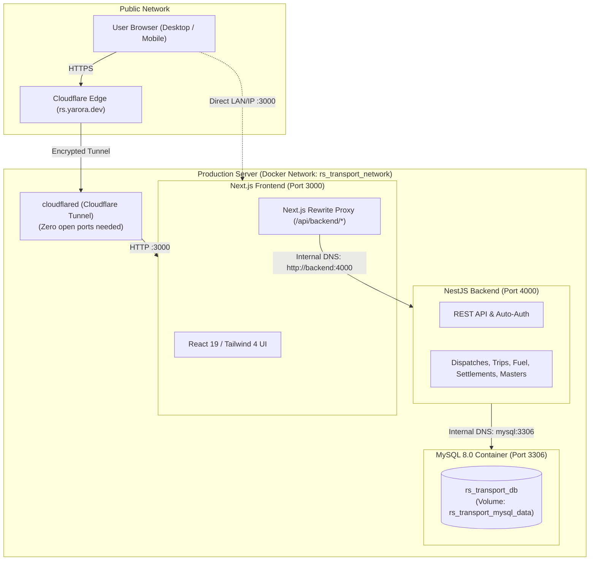

# 🐳 RS Transport ERP — Docker Server Deployment Guide

Complete guide to running **RS Transport ERP** (Next.js Frontend + NestJS Backend + MySQL 8.0 + Cloudflare Tunnel) on any Linux server using Docker & Docker Compose.

---

## 🏗️ 1. Architecture Overview



---

## 📋 2. Server Prerequisites

On your Ubuntu / Debian server, install Docker and the Docker Compose plugin:

```bash
# 1. Update packages
sudo apt update && sudo apt upgrade -y

# 2. Install Docker and Docker Compose
sudo apt install -y docker.io docker-compose-v2

# 3. Enable and start Docker service
sudo systemctl enable --now docker

# 4. (Optional) Allow your user to run Docker without sudo
sudo usermod -aG docker $USER
newgrp docker
```

---

## 🚀 3. Quick Deployment (3 Steps)

### Step 1: Copy Code to Server
Transfer or clone your repository to the server (e.g. into `/opt/rs_transport` or `~/rs_transport`):
```bash
git clone <your-repo-url> /opt/rs_transport
cd /opt/rs_transport
```

### Step 2: Configure Environment Variables
Copy the pre-configured production Docker environment template:
```bash
cp .env.docker.example .env
```
*(Optional)* Edit `.env` with `nano .env` to customize your database password or JWT secret.

### Step 3: Build & Launch
Build all multi-stage production images and launch the containers in the background:
```bash
docker compose up -d --build
```

---

## 🌐 4. Domain & HTTPS Setup (Cloudflare Tunnel)

You can publish the ERP publicly to **`rs.yarora.dev`** (or any domain) without opening any router ports or configuring SSL certificates:

1. In your Cloudflare Zero Trust Dashboard (**Networks** $\rightarrow$ **Tunnels**), copy your Tunnel Token.
2. In `.env`, paste your token:
   ```env
   CLOUDFLARE_TUNNEL_TOKEN="your_copied_cloudflare_token_here"
   ```
3. Run with the tunnel profile:
   ```bash
   docker compose --profile tunnel up -d
   ```
4. Point your Cloudflare Tunnel public hostname to:
   - Service: `HTTP`
   - URL: `frontend:3000`

---

## 🔍 5. Verifying & Managing Containers

| Action | Command |
| :--- | :--- |
| **Check container health** | `docker compose ps` |
| **Stream live application logs** | `docker compose logs -f` |
| **Stream backend logs only** | `docker compose logs -f backend` |
| **Restart the entire stack** | `docker compose restart` |
| **Stop all containers** | `docker compose down` |
| **Update code & redeploy** | `git pull && docker compose up -d --build` |

---

## 💾 6. Database Backups & Maintenance

### Take a Live Database Backup:
```bash
docker compose exec mysql mysqldump -u root -p"rs_erp_secure_pass_2026" rs_transport_db > backup_$(date +%F).sql
```

### Restore a Database Backup:
```bash
docker compose exec -T mysql mysql -u root -p"rs_erp_secure_pass_2026" rs_transport_db < backup_2026-11-13.sql
```

### Database Data Persistence:
All database data is stored safely in a named Docker volume (`rs_transport_mysql_data`). Even if you restart, recreate, or rebuild containers, all records remain completely intact.

